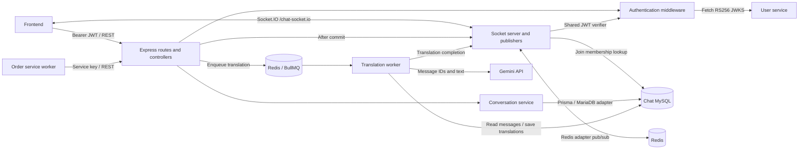
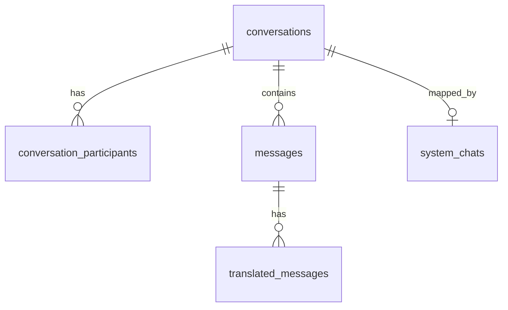

<!--
AI Assistance Disclosure:
Tool: Codex (model: GPT-6), date: 2026-11-10
Scope: Documented existing chat-service implementation, interfaces and integrations.
No requirements, architecture, schema, or API decisions were made by the AI tool.
Author review: tng wen xi
Scope (2026-11-10, Codex, model: GPT-6): Improved readability, expanded schema fields and values, and documented verified endpoint usage.
Author review: tng wen xi
Scope (2026-11-10, Codex, model: GPT-6): Linked recovered endpoint discussions and recorded deferred translation work.
Author review: tng wen xi
Scope (2026-11-10, Codex, model: GPT-6): Removed discussion-history content and kept implementation documentation.
Author review: tng wen xi
Scope (2026-11-10, Codex, model: GPT-6): Removed image/video message types as instructed by the user.
Author review: tng wen xi
-->

# Chat service architecture

Chat service stores order conversations, delivers messages in real time, and prepares per-user translations. It also stores personal notifications in a user's `FoC` system chat.

- [API reference](api.md): endpoints, requests, responses and current callers.
- [Service README](../README.md): setup and runtime configuration.
- [Database schema](#database-schema-and-values): tables, fields and stored values.

This document describes the implementation on 2026-11-10.

## Architecture

The translation worker and HTTP/socket servers run in the same Node process in `src/server.ts`. The Redis boxes represent separate uses of the configured Redis service, not separate required deployments.

| Layer | Existing responsibility | Source |
| --- | --- | --- |
| Bootstrap | Environment validation, Prisma, Redis connections, translation queue/worker, HTTP and sockets, shutdown | [server.ts](../src/server.ts), [env.ts](../src/config/env.ts) |
| HTTP application | JSON parsing and router mounting | [app.ts](../src/app.ts) |
| Authentication | Shared service-key checks or User Service JWT verification | [middleware](../src/middleware/) |
| Routes/controllers | Authentication wiring, Zod validation, HTTP mapping, post-commit publication/enqueue | [routes](../src/routes/), [controller](../src/controllers/conversations.controller.ts) |
| Conversation operations | Persistence, membership rules, pagination, unread counts, idempotency, read positions | [service](../src/services/conversations.service.ts) |
| Realtime | Socket lifecycle, rooms, message/read/translation events | [realtime](../src/realtime/) |
| Translation | BullMQ jobs, batching, Gemini requests and stored translations | [translation](../src/translation/) |

## Service behavior

### Stack and ownership

Stack: Express 5, TypeScript ESM, Prisma 7, MySQL through `@prisma/adapter-mariadb`, Socket.IO, ioredis and BullMQ.

Chat owns conversations, memberships, messages, per-user translations and system-chat mappings. User/order IDs are stored as IDs; chat does not fetch order details or user profiles during these operations.

### Conversations and membership

An order conversation has a unique non-null order ID. Creation inserts the conversation and requester together. Matching retries return the existing conversation; changed requester/title inputs conflict.

A personal system conversation has null order ID, title `FoC`, a participant with null role, and a unique system-chat mapping per user. The first personal notification creates it lazily. Users cannot send messages into it.

Participant addition runs in a transaction and serializes on the active conversation row. An existing user cannot be added again, including a revoked membership. One requester and at most one non-revoked courier are permitted by this operation.

### Messages and read positions

Sending inserts a message and updates conversation `updatedAt` in one transaction, using the same timestamp. Realtime publication and translation enqueue happen after commit; their failures are logged and do not undo the message.

History and listing use descending timestamp/UUID cursor pagination. Unread counts exclude the user's own messages, include null-sender messages, and use the stored read position. Read updates use compare-and-set retries and never move backwards.

### History, notifications and access

Revoked participants retain list/details/history access but cannot send, mark read, enable translation or join a chat room. Archiving changes status only; it preserves membership and history and blocks new messages. Read and translation updates do not reject a conversation solely because it is archived.

System notifications use caller-supplied message UUIDs for deduplication. Identical replay returns 200 without another event, including after archive; mismatched replay returns 409.

REST and sockets share RS256 verification against User Service JWKS. Keys are cached for five minutes and refreshed for unknown key IDs. User identity comes from `sub`; the reserved `SYSTEM` subject is rejected. Service-key authentication is endpoint-specific; see the reference.

Sockets join `user:<id>` automatically and `chat:<id>` on request. The Redis adapter uses key `chat-socket.io`. A message broadcasts to the union of the chat room and active participant user rooms.

## Database schema and values

Source: [Prisma schema](../prisma/schema.prisma). Field names below are the **database column names**; API responses use camelCase.

All ID columns are `CHAR(36)`. Generated IDs use UUIDs. All timestamps are `DATETIME(3)` (millisecond precision). “Nullable” means SQL `NULL` is allowed; otherwise the field is required. Timestamps with a default use `now()`.

### conversations

One row per order chat or personal system chat.

| Column | Type / default | Values and meaning |
| --- | --- | --- |
| `conversation_id` | ID; primary key; generated UUID | Chat identifier |
| `order_id` | ID; nullable; unique | Order ID for order chats; null for personal system chats |
| `chat_title` | TEXT | Order description at creation; `FoC` for personal system chats |
| `status` | Enum; default `ACTIVE` | `ACTIVE`: accepts messages; `ARCHIVED`: history remains, new messages blocked |
| `created_at` | Timestamp; default now | Creation time |
| `updated_at` | Timestamp; default now | Set when a message is inserted; not automatically updated by every change |

There is a composite index on `(updated_at, conversation_id)`. The archive operation does not change `updated_at`.

### conversation_participants

One row represents a user's membership and preferences in a conversation.

| Column | Type / default | Values and meaning |
| --- | --- | --- |
| `id` | ID; primary key; generated UUID | Membership identifier |
| `chat_id` | ID; foreign key | References `conversations.conversation_id` |
| `user_id` | ID | User Service user ID |
| `role` | Nullable enum | `REQUESTER`, `COURIER`; null for the personal system-chat participant |
| `last_read_message_id` | Nullable ID | Last retained read position; null means no stored read position |
| `joined_at` | Timestamp; default now | Membership creation time |
| `revoked_at` | Nullable timestamp | Null means membership has not been revoked; timestamp means revoked |
| `translate_to` | Nullable VARCHAR(2) | Null means auto-translation off; API accepts the language codes below |

| Code | Language |
| --- | --- |
| `en` | English |
| `zh` | Chinese |
| `hi` | Hindi |
| `ta` | Tamil |
| `ms` | Malay |
| `es` | Spanish |
| `ar` | Arabic |

Language validation is in the application; `translate_to` is a string column, not a database enum. Membership limits (one requester, at most one active courier, no repeated user) are enforced by the participant-add operation, not unique constraints on this table. `last_read_message_id` is not declared as a Prisma foreign key.

### messages

One row per persisted user message or service notification.

| Column | Type / default | Values and meaning |
| --- | --- | --- |
| `id` | ID; primary key; generated UUID | Normal sends generate an ID; notifications supply one for retry deduplication |
| `chat_id` | ID; foreign key | References `conversations.conversation_id` |
| `sender_id` | Nullable ID | Verified user ID for user sends; null for service sends and SYSTEM notifications |
| `type` | Enum | `TEXT`, `SYSTEM` |
| `content` | Nullable TEXT | Original message text; current send APIs require nonblank text |
| `triggered_by_user_id` | Nullable ID | User who triggered an order notification; distinct from sender; null if absent |
| `created_at` | Timestamp; default now | Message creation time |

The normal send endpoint accepts only `TEXT`; the notification endpoint writes `SYSTEM`.

### translated_messages

One stored translation per message and recipient user.

| Column | Type / default | Values and meaning |
| --- | --- | --- |
| `id` | ID; primary key; generated UUID | Translation identifier |
| `message_id` | ID; foreign key | References `messages.id` |
| `user_id` | ID | User receiving this translation |
| `content` | TEXT | Translated text, or literal `SAME` when already in the target language |
| `created_at` | Timestamp; default now | Translation storage time |

The pair `(message_id, user_id)` is unique. This table has no language column; the participant's `translate_to` stores the selected language. Changing between enabled languages deletes that user's previous translations for the conversation.

### system_chats

Maps each user to their personal notification conversation.

| Column | Type / constraint | Values and meaning |
| --- | --- | --- |
| `user_id` | ID; primary key | One mapping per user |
| `conversation_id` | ID; unique; foreign key | References `conversations.conversation_id`; one mapping per conversation |

### Relationships and constraints

- Conversation → participants/messages and message → translations use foreign keys with restricted deletion and update.
- Conversation → system-chat mapping cascades deletion and update of the referenced key.
- User IDs and order IDs are stored references to other services, without cross-service database foreign keys.
- Nullable columns without another default begin as null when omitted. The service explicitly supplies shared timestamps for conversation creation and message insertion.

## Integration with other services

| Integration | Direction and behavior | Evidence |
| --- | --- | --- |
| Frontend | Calls conversation/history/send/read/translation APIs with JWT; receives Socket.IO messages, read receipts and translations | [chat API client](../../frontend/src/api/chat.js), [socket client](../../frontend/src/realtime/chatSocket.js) |
| User service | Chat fetches `/auth/.well-known/jwks.json` from `USER_SERVICE_URL`; no per-request user-profile lookup | [authenticate.ts](../src/middleware/authenticate.ts) |
| Order service | Its worker creates chat, sends the creation notification, adds courier by order ID, sends lifecycle notifications and archives after final notification. Requests carry `X-Service-Name: order-service` and shared `X-Service-Key`. Network/5xx failures are classified transient by the caller; other non-2xx responses are permanent | [chat.client.ts](../../order-service/src/clients/chat.client.ts), [order README](../../order-service/README.md) |
| Other service callers | Shared-key notification API accepts order notifications or personal notifications. This capability does not by itself establish an implemented caller in every service | [caller guide](../SYSTEM-NOTIFICATIONS.md) |
| Redis | Socket adapter pub/sub plus BullMQ `queue:chat:translation`; configured through REDIS_HOST/PORT/TLS | [server.ts](../src/server.ts), [queue.ts](../src/translation/queue.ts) |
| Gemini | Receives batches of up to 20 message ID/text pairs and target language; JSON values become per-user stored translations. `SAME` means already in target language | [worker.ts](../src/translation/worker.ts), [gemini.ts](../src/translation/gemini.ts) |

### Translation flow

Translation enablement queues a backfill of untranslated received TEXT/SYSTEM messages. New sends queue translations for active recipients with translation enabled.

Jobs have five attempts and exponential backoff starting at one second; completed jobs are removed.

The worker checks membership and language before processing. Changing between enabled languages deletes previous stored translations; disabling preserves them. Completion emits to the target user's room only.

## Runtime configuration

| Variable | Required / default | Purpose |
| --- | --- | --- |
| `DATABASE_URL` | Required | Chat MySQL connection |
| `CHAT_SERVICE_API_KEY` | Required | Shared service credential |
| `TRANSLATION_LLM_KEY` | Required, even with translation off | Gemini credential |
| `PORT` | `3000` | HTTP and socket listener |
| `USER_SERVICE_URL` | `http://user-service:3001` | JWKS host |
| `REDIS_HOST` / `REDIS_PORT` | `localhost` / `6379` | Queue and socket adapter Redis |
| `REDIS_TLS` / `DB_SSL` | `false` / `false` | Redis / MySQL TLS switches |
| `TRANSLATION_LLM_MODEL` | `gemini-3.1-flash-lite` | Configured model name |

Compose exposes chat on host port 3005 by default; other containers use `http://chat-service:3000`. The database adapter supports configured TLS. HTTP keep-alive/header timeouts are 65/66 seconds. `/health` checks the database only; it does not establish Redis, JWKS or Gemini health. Consult the service README and Compose configuration for deployment instructions.
